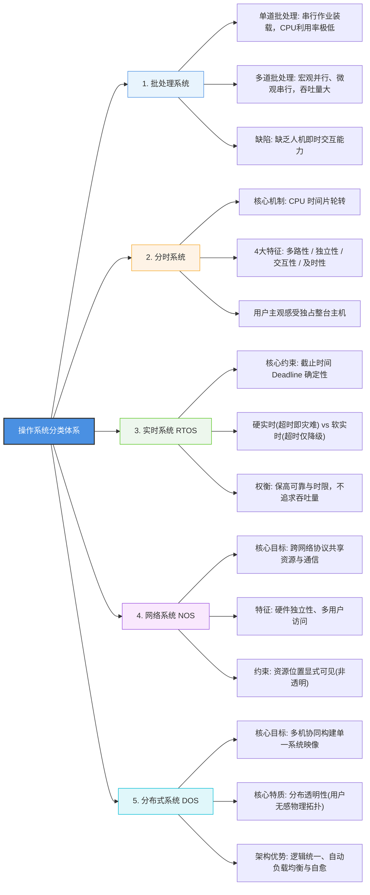

很多同学在学习操作系统或备考软考（系统架构设计师 / 软件设计师 / 系统分析师）时，一看到系统分类这一章，往往觉得不过是背背概念：单道、多道、分时、实时、分布式……

但一做题或者真到了工程选型时，却经常被几个看似简单的细节绊倒：
- 为什么多道批处理叫“宏观并行、微观串行”？它到底为什么做不到人机交互？
- 分时系统的“时间片轮转”是怎么做到让每个人都觉得独占整台电脑的？
- 为什么工业控制里的实时系统（RTOS）反而极力避免让 CPU 满负荷运转？
- 网络操作系统和分布式操作系统，到底谁才是“物理透明”的？

这篇文章抛开教科书上的生硬官话，用工程师的技术直觉把这 5 类操作系统的设计哲学、调度机制和易错陷阱彻底理清。

---

## 一、知识全景思维导图

### 5 大操作系统选型与特性对比速查

| 系统分类 | 核心调度机制 | 关键技术指标 | 核心优势 | 软考高频避坑考点 |
| :--- | :--- | :--- | :--- | :--- |
| **单道批处理** | 作业单道串行执行 | 资源利用率极低 | 逻辑极其简单 | CPU 与 I/O 串行等待，严重浪费算力 |
| **多道批处理** | 多作业内存并发轮换 | 吞吐量大、利用率高 | **宏观并行，微观串行** | **完全缺乏人机交互能力**，作业提交后不可中途干预 |
| **分时系统** | CPU 时间片轮转调度 | 快速响应（秒级/亚秒级） | **多路性、独立性、交互性、及时性** | 用户暴增时响应变慢，不适用于严格安全控制 |
| **实时系统 (RTOS)** | 优先级抢占 + 时限约束 | **时限（Deadline）确定性** | 极端高可靠、事件响应极快 | **不追求吞吐量和 CPU 满负荷**，刻意预留算力冗余 |
| **网络操作系统** | 网络协议通信与共享 | 硬件独立性、访问控制 | 跨机器共享文件/打印设备 | **位置非透明**（必须显式指定目标 IP 或共享路径） |
| **分布式操作系统** | 全局分布式协同调度 | **单一系统映像** | **分布透明性**（全网多机协同，用户无感） | 系统设计与分布式一致性协议极度复杂 |

---

## 二、关键技术点与避坑拆解

### 1. 批处理系统：单道 vs 多道
- **单道批处理**：一次只把一个作业调入内存运行。当作业等待 I/O 读写时，CPU 只能傻等摸鱼，计算和 I/O 严重脱节。
- **多道批处理（高频考点）**：
  - **并发原理**：把多个作业同时装入内存。作业 A 在等磁盘 I/O 时，CPU 立刻切换去跑作业 B，算力被充分压榨。
  - **八字真言**：**「宏观上并行，微观上串行」**。宏观上看多个作业都在推进，但在单核微观视角下，任意时刻只有一个作业占用 CPU。
  - **最大缺点**：**没有任何交互能力**。作业必须写好批处理脚本一次性提交，中途既不能像现代终端那样敲命令调试，也不能即时查看中间结果。

---

### 2. 分时系统：时间片轮转与四大特征
为了解决“批处理缺乏交互”的问题，分时系统诞生了。它通过时钟中断把 CPU 运行时间切分成微小的**时间片（Time Slice）**，轮流给各个终端分配算力。

必须熟记它的 4 大标准特征：
1. **多路性**：一台主机挂载多个终端，多名用户同时在线操作。
2. **独立性**：虽然大家共用一台主机，但各终端在逻辑上互相隔离，主观感觉就像自己独占了整台电脑。
3. **交互性**：支持人机即时对话，输入命令立刻返回结果。
4. **及时性**：时间片轮转极快，用户的请求能在眨眼之间得到响应。

---

### 3. 实时系统（RTOS）：为什么不追求 CPU 利用率？
实时系统最核心的约束不是“算得多快”，而是**“能不能在规定时间（Deadline）内给出确定响应”**：
- **硬实时（Hard Real-Time）**：必须在绝对截止时间内完成，一旦超时就会造成灾难性后果（如火箭发射、汽车安全气囊、自动紧急制动 AEB、核电控制）。
- **软实时（Soft Real-Time）**：偶尔超时只会降低服务质量，不会死人（如视频直播推流、网购抢票）。
- **避坑重点**：实时系统追求的是**“极端的高可靠与确定性”**，而不是吞吐量和 CPU 满负荷！在工程设计中，为了保证紧急任务能第一时间插队执行，实时系统往往刻意留出充足的空闲算力冗余。

---

### 4. 网络系统 vs 分布式系统（最易混淆考点）
两者都能跨机器通信和共享资源，最本质的区别在于**“透明性（Transparency）”**：
- **网络操作系统（NOS）**：
  好比传统的 Linux 文件服务器或 Windows 共享文件夹。客户端必须明确知道服务器的 IP 或共享路径（比如 `\\192.168.1.100\share`），**资源位置是非透明的**。
- **分布式操作系统（DOS）**：
  底层由数十上百台机器协同组成，但在逻辑上对外呈现为**“单一系统映像（Single System Image）”**。用户提交一个任务，根本不需要知道它到底在哪台机器上跑，系统底层自动搞定分布式调度、负载均衡和容错恢复，具备极高的**分布透明性**。

---

## 三、测试题

### 第 1 题：多道批处理与分时系统特征
**【单选题】**  
在操作系统的发展演进历程中，关于多道批处理系统与分时操作系统的表述，下列选项中**不正确**的是（ ）。  
A. 多道批处理系统允许多个作业同时存放在内存中，在宏观上并行执行，微观上单核 CPU 串行交替运行  
B. 多道批处理系统的主要设计目标是提高系统资源利用率和吞吐量，但缺乏人机即时交互能力  
C. 分时操作系统基于时间片轮转技术，具备多路性、独立性、交互性和及时性四大特征  
D. 在分时操作系统中，为保障多用户的使用体验，分配给每个终端的时间片长度必须随着在线用户数的增加而线性延长  

👉 点击展开【答案与深度解析】

**【正确答案】**：**D**  
**【深度解析】**：
* **D 项错误（符合题意）**：分时系统的响应时间大致满足 $T \approx N \times q$（$N$ 为在线终端数，$q$ 为时间片大小）。如果在线用户数 $N$ 增加时时间片 $q$ 还跟着延长，会导致系统的响应延迟以平方级膨胀，用户会感受到极度卡顿，交互性彻底失效。实际工程中时间片大小通常保持固定或微调，超载时应限制并发接入，绝不能盲目拉长时间片。
* **A、B 项正确**：多道批处理的核心机制正是“宏观并行、微观串行”，吞吐量大但无交互能力。
* **C 项正确**：多路性、独立性、交互性、及时性是分时系统的四大官方标准定义特征。

---

### 第 2 题：网络系统 vs 分布式系统
**【单选题】**  
在现代操作系统体系中，网络操作系统（NOS）与分布式操作系统（DOS）均可实现多机互联与协同，二者最本质的架构设计区别在于（ ）。  
A. 网络操作系统支持异构硬件平台，而分布式操作系统仅能运行在同构集群上  
B. 网络操作系统中的资源物理位置对用户显式可见（非透明），而分布式操作系统具备分布透明性并对外呈现单一系统映像  
C. 网络操作系统只能管理单台计算机的本地资源，无法实现跨主机的资源共享与协同  
D. 分布式操作系统的任务调度由各物理机本地调度器独立完成，不存在全局协同控制  

👉 点击展开【答案与深度解析】

**【正确答案】**：**B**  
**【深度解析】**：
* **B 项正确**：这是极高频的经典对比考点。网络操作系统资源位置显式可见（用户必须指定目标 IP 或共享路径）；而分布式操作系统对外呈现为“单一系统映像”，具备高度的“分布透明性”，用户无需感知底层物理节点。
* **A 项错误**：分布式系统同样可以运行在异构机型上。
* **C 项错误**：网络操作系统的核心功能正是跨机器共享资源。
* **D 项错误**：分布式操作系统必须具备全局分布式调度与协调机制，并非单纯由本地各自为政。

---

### 第 3 题：实时系统核心设计权衡
**【单选题】**  
在某航空航天飞行器姿态控制系统及车载自动紧急制动系统（AEB）的设计中，通常必须选用实时操作系统（RTOS）。下列关于该实时系统设计原则与特性的说法，**最恰当**的是（ ）。  
A. 该系统属于典型的软实时系统，在系统峰值过载时允许任务适当超时以换取更低的硬件功耗  
B. 该系统设计的主要目标应当是追求系统整体吞吐量最大化，以及 CPU 核心的极限满载利用率  
C. 该系统对任务响应的截止时间（Deadline）具有强确定性要求，一旦超时可能导致灾难性后果  
D. 实时操作系统为了保障极简与快速响应，通常禁用任务抢占机制，严格采用先来先服务（FCFS）算法调度  

👉 点击展开【答案与深度解析】

**【正确答案】**：**C**  
**【深度解析】**：
* **C 项最恰当**：飞行器控制和汽车刹车关乎人身安全，属于典型的硬实时系统，必须在严格的截止时间（Deadline）内给出确定响应，超时即灾难。
* **A 项错误**：误将硬实时混同于软实时。
* **B 项错误（高频命题陷阱）**：实时系统追求的是高可靠与时限确定性，而不是吞吐量和 CPU 满负荷！
* **D 项错误**：硬实时系统通常必须采用基于优先级的抢占式调度算法，才能保证紧急任务在第一时间抢占 CPU 响应。

