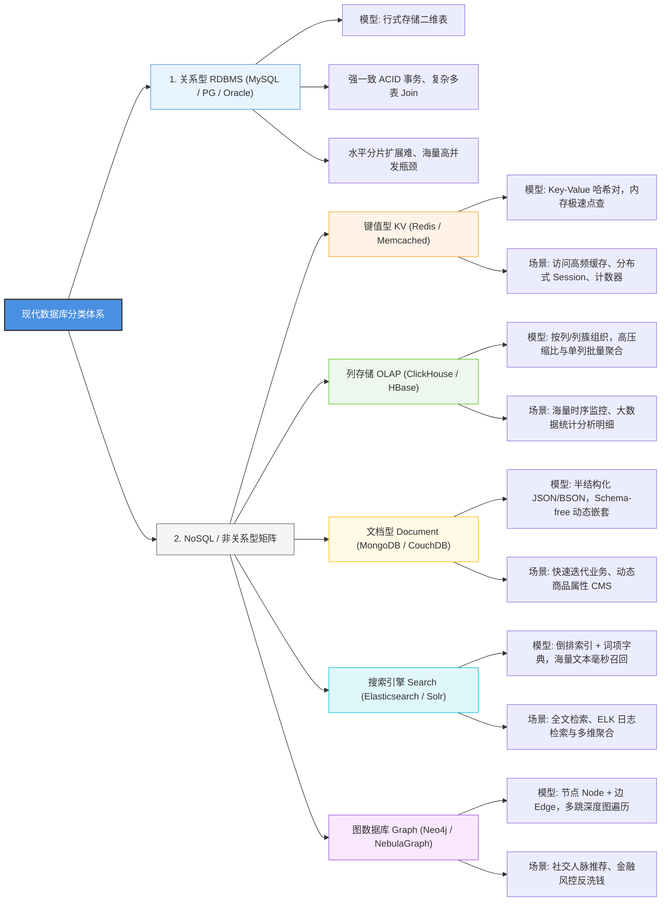

做后端开发或者备战软考（系统架构设计师 / 软件设计师 / 系统分析师）时，很多人把时间全花在背范式、写复杂 SQL 上。但真正到了实际系统设计或考场案例题时，最容易被问倒的反而是：**面对不同的业务场景，底层到底该选哪种数据库？**

- 为什么列存数据库（ClickHouse / HBase）跑聚合统计飞快，单行写入却慢如蜗牛？
- 文档数据库（MongoDB）所谓的 JSON/BSON 自由模式，究竟解决了什么痛点？
- 搜索引擎（Elasticsearch）凭什么能在亿级文本里毫秒召回？它的倒排索引到底是怎么存的？
- 朋友圈人脉、反欺诈资金链这种关系网络，为什么一定要上图数据库（Neo4j）？

这篇文章抛开死记硬背的教材官话，从工程落地的角度，把关系型与 5 类主流 NoSQL 数据库的数据模型、读写特征和选型避坑点一次性彻底讲通。

---

## 一、知识全景思维导图

### 6 大数据库架构选型核心对比速查

| 存储类型 | 核心数据模型 | 事务与一致性 | 查询特征 | 典型适用场景 | 架构设计避坑点 |
| :--- | :--- | :--- | :--- | :--- | :--- |
| **关系型 (RDBMS)** | 行式存储二维表 | 严格 ACID、强一致 | 复杂跨表 Join、标准 SQL | 银行核心账户、电商交易订单 | 海量数据分库分表复杂，水平扩展难 |
| **键值型 (KV)** | Key-Value 键值对 | 最终一致 / 单操作原子 | 单键 $O(1)$ 精确命中 | 分布式缓存、Session 共享、计数器 | 不支持范围扫描与复杂多字段检索 |
| **列存储 (OLAP)** | 按列/列簇组织存储 | 弱事务 / 批量写入 | 单列批量聚合（SUM/AVG） | 大数据统计报表、时序指标监控 | **严禁高频单行点查点改**（吞吐严重倒挂） |
| **文档型 (Document)** | 半结构化 JSON/BSON | 局部一致 / 文档级原子 | 灵活字段查询、嵌套下钻 | 快速迭代产品、动态商品属性 CMS | 模式自由容易导致字段数据膨胀失控 |
| **搜索引擎 (Search)** | 倒排索引 + 词项字典 | 近实时（NRT）刷新 | 全文模糊检索、分词高亮 | 日志海量分析检索、电商商品搜索 | 频繁单条更新会造成段合并严重 I/O 抖动 |
| **图数据库 (Graph)** | 图论（节点与边） | 局部图一致性 | 复杂关系多跳遍历（$N$ 度人脉） | 社交网络、金融风控反洗钱、知识图谱 | 大规模图分区（Graph Partitioning）切分极难 |

---

## 二、6 类数据库底层机制与选型逻辑

### 1. 关系型数据库（RDBMS）：事务基石
- **模型本质**：行式存储二维表。整行记录存放在一起，以主键索引组织数据页。
- **擅长**：严格的 ACID 事务、强一致性校验、复杂的跨表 JOIN 操作。
- **软肋**：当表数据量突破千万、过亿时，B+ 树深度增加，写入性能下降；做水平分库分表（Sharding）极其痛苦，跨库事务成本极高。

---

### 2. 键值数据库（Key-Value）：极致点查
- **模型本质**：哈希映射表（如 Redis、Memcached）。
- **擅长**：常驻内存，凭借 $O(1)$ 的寻址复杂度支撑每秒数十万的极高并发读写。
- **软肋**：无法支持范围查询或基于某个内部属性过滤。典型用于会话 Session、高频计数、热点缓存。

---

### 3. 列存储数据库（OLAP）：海量分析利器
- **模型本质**：把同一列的数据紧挨着物理存储（如 ClickHouse、HBase）。
- **为什么分析极快**：
  做统计（如 `SELECT AVG(age) FROM users`）时，行存必须把每行包含姓名、地址的整条记录全读进内存，产生海量无效 I/O；而列存只需要读取 `age` 这一列的物理块即可，I/O 节约 90% 以上！同列同类型数据还能做到极高的压缩比。
- **避坑必背**：**千万别拿列存做 OLTP 的高频单行点查点改！** 写入一条包含 50 个字段的记录，列存要把数据拆散写到 50 个不同的列文件中，产生 50 次离散写，性能会发生灾难性倒挂。

---

### 4. 文档数据库（Document）：敏捷与反范式
- **模型本质**：以层次化的半结构化文档（JSON / BSON / XML）为存储单元（典型代表 MongoDB）。
- **擅长**：**Schema-free（无固定模式）**。每条文档的字段可以不一样，支持数组和对象深层嵌套。比如电商商品，手机有“屏幕刷新率、摄像头”，衣服有“尺码、材质”，用关系型要建几十张扩展属性表，而在文档数据库里直接嵌成一个 JSON 对象，单次读出，零 JOIN 操作。
- **软肋**：弱事务性，字段缺乏严格类型约束，长期迭代容易导致数据脏乱膨胀。

---

### 5. 搜索引擎数据库（Search Engine）：全文近实时召回
- **模型本质**：**倒排索引（Inverted Index）**（典型代表 Elasticsearch）。
- **实现机理**：把传统“文档 ID $\rightarrow$ 单词”的正向关系，反转为“单词 $\rightarrow$ [文档1, 文档2, 文档3]”的倒排列表。查询时先查词典定位包含该词的所有文档 ID，毫秒级得出交集并结合相关度算法打分。
- **软肋**：近实时刷新（NRT），数据写入通常有秒级可见延迟；单条高频更新会引发底层分段合并（Segment Merge）造成磁盘 I/O 抖动。

---

### 6. 图数据库（Graph Database）：关系网络首选
- **模型本质**：图论结构，核心实体只有两样：**节点（Node）**与**边（Edge）**（典型代表 Neo4j）。
- **为什么比关系型更快**：节点之间通过指针物理引用（无索引邻接），查询“张三的好友的好友有没有在同一个群”时，直接顺着指针跳跃即可，复杂度只与局部子图相关；而如果用关系型做 5 层人脉遍历，需要进行 5 次昂贵的自连接（Self Join），甚至直接跑死数据库。

---

## 三、测试题

### 第 1 题：各数据库数据结构特征辨析
**【单选题】**  
在现代数据库与存储体系中，不同类型的数据库采用了截然不同的底层数据模型与组织方式。下列关于各类数据库数据结构特征的叙述中，**错误**的是（ ）。  
A. 关系型数据库以严格的“二维表（Table）”为逻辑结构，支持通过外键与 SQL 规范进行复杂的多表关联查询  
B. 键值（Key-Value）数据库以“键-值对集合”形式存储数据，其核心优势是寻址简单高效、内存读取速度极快  
C. 文档数据库通常采用 XML、JSON、BSON 等半结构化文档格式存储数据，要求每条记录必须具备严格统一且不可动态变更的 Schema 模式  
D. 搜索引擎数据库通过构建以词项为核心的特定存储格式（倒排索引），实现对海量非结构化文本的极致快速检索  

👉 点击展开【答案与深度解析】

**【正确答案】**：**C**  
**【深度解析】**：
* **C 项错误（符合题意）**：文档数据库最核心的特质正是 **Schema-free（无固定模式 / 动态模式）**，集合内的各个文档允许拥有完全不同的字段和层级，支持敏捷扩展，绝不要求每条记录具备不可变更的统一 Schema。
* **A、B、D 项描述均正确**。

---

### 第 2 题：行式存储 vs 列式存储应用权衡
**【单选题】**  
列存储数据库（Column-oriented Database）与传统关系型行存储数据库相比，在底层存储架构与计算特征上存在显著差异。下列关于列存储数据库的表述中，**不正确**的是（ ）。  
A. 列存储数据库将同一列的数据在物理存储介质上连续集中存放，极利于同类型数据的批量高压缩比存储  
B. 在进行海量数据的聚合统计（如 `SUM`、`AVG`、`COUNT` 等针对特定几列的 OLAP 分析）时，列存储能显著减少磁盘 I/O 开销  
C. 列存储数据库非常适合包含频繁单条记录整行写入（如 `INSERT INTO ... VALUES (...)`）的高并发联机事务处理（OLTP）系统  
D. 列存储数据库对包含大量空值（NULL）的稀疏列具有极高的存储效率，通常不会为空字段浪费物理磁盘空间  

👉 点击展开【答案与深度解析】

**【正确答案】**：**C**  
**【深度解析】**：
* **C 项错误（符合题意）**：列存储将各列物理拆开单独存储，单条整行写入需要拆解写入多个离散的列文件中，产生多次离散随机 I/O，因而极不适合高并发单条写入的 OLTP 业务。列存专为海量批量导入与分析型统计（OLAP）而生。
* **A、B、D 项描述均符合列存储技术特性**。

---

### 第 3 题：典型业务场景下的存储选型决策
**【单选题】**  
某大型电商平台在重构其底层数据中台与业务系统时，系统架构师需根据不同业务场景的访问特性选型适配的数据库。下列选型决策中，**最不合理**的是（ ）。  
A. 用户在线登录 Session 状态与秒杀活动实时库存计数器：采用键值数据库（如 Redis），利用内存高速读写支撑每秒数十万级并发  
B. 核心交易订单创建与用户资金账户清结算中心：采用关系型数据库（如 PostgreSQL / MySQL），严格依赖 ACID 强一致性保障资金零误差  
C. 海量多变且频繁变动规格属性的商品详情信息（SPU / SKU）：采用文档数据库（如 MongoDB），利用其 Schema-free 动态嵌套结构支撑业务多变性  
D. 亿级用户间的社交好友关注关系与风控洗钱多层资金链路穿透追踪：采用关系型二维表通过多重多级表自连接（Self Join）及递归外键关联实现最优查询性能  

👉 点击展开【答案与深度解析】

**【正确答案】**：**D**  
**【深度解析】**：
* **D 项决策最不合理**：多度社交好友和反欺诈洗钱资金链路属于深度图遍历问题。关系型数据库进行多级关联必须依赖代价极高的多表自连接（Self Join）或递归查询，计算复杂度呈指数级爆炸，甚至直接拖垮数据库。此类高密度关系网络场景，首选应是**图数据库（Graph Database，如 Neo4j、NebulaGraph）**。
* **A、B、C 均为工业界标准选型**。

