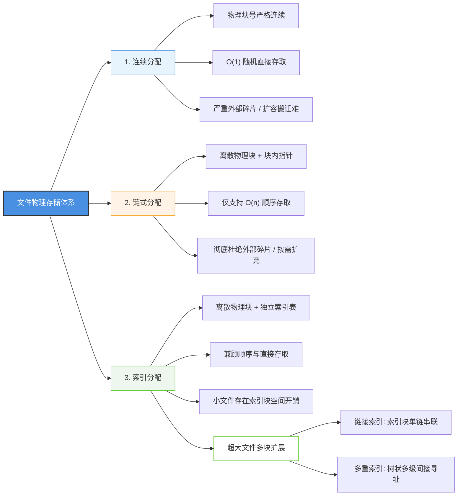

我们在操作系统里新建一个文件、写入数据，底层的磁盘和操作系统究竟是怎么安排这些数据块存放的？

在操作系统的文件存储管理中，有三种最基础、最经典的物理分配方式：**连续分配、链式分配、索引分配**。无论是日常做底层架构设计，还是备考软考（系统架构设计师 / 软件设计师），这三种方式的读写性能、空间碎片和动态扩容机制，都是必考的高频重点。

---

## 一、知识全景思维导图

### 三大物理结构核心对比速查

| 物理结构     | 数据块分布       | 存取方式支持                 | 空间碎片情况     | 动态扩容能力         | 核心考点与避坑点                  |     |
| :------- | :---------- | :--------------------- | :--------- | :------------- | :------------------------ | --- |
| **连续分配** | 连续物理块号      | **顺序 + 随机**（$O(1)$ 计算） | **严重外部碎片** | 极差（容易引发数据整体搬家） | 寻道最快，但扩容极难，创建时需预估大小       |     |
| **链式分配** | 离散物理块 + 指针  | **仅支持顺序存取**（$O(n)$ 遍历） | **无外部碎片**  | 极好（只要有空闲块即可追加） | **不支持跨块直接跳转**，指针占用块内有效空间  |     |
| **索引分配** | 离散物理块 + 索引表 | **顺序 + 随机**（查表直达目标块）   | **无外部碎片**  | 极好（随时分配新块登记入表） | 兼顾性能与扩容，但小文件存在**索引块空间浪费** |     |

---

## 二、核心机制深入拆解

### 1. 先理清：逻辑结构 vs 物理结构

很多初学者容易在这里犯迷糊（甚至在做笔记时都会先写成“逻辑结构”，然后再涂改成“物理结构”）：
* **逻辑结构**：是**用户和开发者眼中看到的样子**，跟磁盘长什么样完全无关。比如代码文件、txt 文本文档就是无结构的**流式文件**（字节流）；数据库的一张表、员工档案则是**记录式文件**（一条条记录）。
* **物理结构**：是操作系统在**底层磁盘块上具体怎么分配摆放**的。也就是我们接下来要讨论的连续、链式与索引分配。

---

### 2. 三种物理分配机制的底层逻辑

#### （1）连续分配（Contiguous Allocation）
连续分配的思路最简单：给文件分配一组**磁盘物理编号连续**的块。
* **寻址原理**：目录项里只需要存两样东西：`起始物理块号` 和 `文件长度`。如果要访问文件的第 $i$ 个逻辑块，直接算：
  $$\text{物理块号} = \text{起始块号} + i$$
  时间复杂度是 $O(1)$，天然支持极速的随机存取，磁头寻道距离也最短。
* **致命缺陷**：
  1. **外部碎片严重**：文件频繁创建和删除后，磁盘会被切成很多零碎的小空闲区，明明总空间够，却因为凑不出一整块连续空间而无法存放大文件。
  2. **很难动态扩容**：文件追加内容时，如果紧挨着的下一块已经被别的程序占了，操作系统就必须把整批数据找个更大的空地整体“搬迁”，代价极高。

#### （2）链式分配（Linked Allocation）
为了解决碎片和扩容问题，链式分配把文件离散放到各个空闲物理块上，每个块腾出几个字节存放指向下一个块的指针。
* **优点**：磁盘利用率极高，彻底告别外部碎片；文件追加内容只要随手拿一个空闲块串进链尾即可。
* **代价（高频易错点）**：
  1. **不支持随机直接访问**：想读第 $n$ 个块，没法直接算出来，必须从第 1 个块顺着指针挨个读完前 $n-1$ 个块（耗费 $n$ 次磁盘 I/O），只能顺序存取。
  2. **稳定性和开销**：指针要占数据块的有效空间；只要中间某个块坏道导致指针断裂，后面的数据全丢。
  *(注：如果把所有指针抽出来集中放到内存里的一张全局表里管理，就是经典的 FAT 文件系统)*

#### （3）索引分配（Indexed Allocation）
索引分配是现代文件系统最常用的折中方案：数据依然离散存放在各个物理块中，但系统为每个文件单独建一张**索引表**（放在一个专用的索引块里）。
* **寻址原理**：索引表就像一张数组，下标是逻辑块号，数组值是对应的物理块号。目录项（FCB/Inode）只需要记录这个索引块的起始地址即可。
* **优势与代价**：
  * 它既有连续分配的随机读写能力（查索引表直接定位目标块），又有链式分配灵活扩充、零外部碎片的好处。
  * 代价是**索引块本身要占磁盘空间**。如果一个文件只有几十字节，系统也必须给它分配一个完整的索引块（通常 4KB），元数据开销比例很大。

---

### 3. 文件太大，单个索引块装不下怎么办？

一个磁盘物理块通常是 4KB，假设一个块地址占 4 字节，那么一个索引块最多只能装 $4\text{KB} / 4\text{B} = 1024$ 个指针，对应管理 $1024 \times 4\text{KB} = 4\text{MB}$ 的文件。面对几个 GB 甚至 TB 的大文件，单个索引块显然不够用。

操作系统通常有两种扩展方式：

1. **链接索引方式（Chained Indexing）**：
   把多个索引块像链表一样串起来。第一个索引块存满了，最后一个指针指向第二个索引块。
   * **缺点**：如果要读大文件尾部的数据，依然得把前面的索引块挨个读一遍，顺序遍历的 I/O 次数较多。
2. **多重索引方式（Multilevel Indexing，多级间接寻址）**：
   像树一样分层：
   * **一级间接索引**：索引块里的指针直接指向数据块。
   * **二级间接索引**：顶级索引块里的指针指向“下一级索引块”，下一级索引块里的指针才指向真正的数据块。
   * **核心优势**：寻道路径固定且可控。二级索引只需要 2 次索引读取 + 1 次数据读取，寻址容量却呈指数级扩大。经典的 UNIX/Linux Inode 结构（直接地址项 + 一级间接 + 二级间接 + 三级间接）就是靠这套机制支撑起超大文件的。

---

## 三、测试题

### 第 1 题：逻辑结构与物理结构辨析
**【单选题】**  
在操作系统文件管理体系中，区分文件的“逻辑结构”与“物理结构”是深入理解底层 I/O 调度的前提。下列关于这两种结构的表述中，**正确**的是（ ）。  
A. 连续结构、链式结构与索引结构属于文件的逻辑结构，是面向终端用户呈现的层次视图  
B. 流式文件与记录式文件属于文件的物理结构，由操作系统底层根据磁盘介质特性进行编址与分配  
C. 逻辑结构是用户从应用视角观察到的信息组织方式，物理结构则是操作系统将文件数据映射至物理存储介质上的具体分配方式  
D. 无论文件采用何种物理存储结构，在磁盘存储器中其逻辑块号与物理块号都必须保持严格一一对应的线性升序关系  

👉 点击展开【答案与深度解析】

**【正确答案】**：**C**  
**【深度解析】**：
* **C 项正确**：逻辑结构是面向用户和程序员视角的（如无格式字符流、结构化数据记录）；物理结构则是操作系统在外存物理块上的实际组织和分配机制。
* **A、B 项颠倒**：流式文件和记录式文件属于逻辑结构；连续、链式和索引属于物理结构。
* **D 项错误**：在链式和索引结构中，物理块是离散分配的，物理块号不需要也不可能与逻辑块号保持线性升序。

---

### 第 2 题：三种分配方式的性能取舍
**【单选题】**  
操作系统在设计文件物理存储分配策略时，需要在访问速度、存储碎片以及动态扩展性之间进行权衡。关于连续分配、隐式链式分配与索引分配的对比，下列说法中**错误**的是（ ）。  
A. 连续分配方式由于物理块严格连续，磁头寻道开销极小，且支持通过计算公式实现物理块地址的直接/随机存取  
B. 隐式链式分配消除了外部碎片且便于文件动态追加扩容，但不支持直接跳跃寻址，读取第 $n$ 个物理块必须遍历前 $n-1$ 个块的指针  
C. 索引分配兼顾了顺序存取与随机存取能力，且由于每个文件独立分配索引表，彻底杜绝了任何形式的存储空间额外开销  
D. 连续分配在文件创建时通常必须预先声明或预估文件长度，若后续追加写入时相邻连续物理块已被占用，可能导致整盘大块数据迁移  

👉 点击展开【答案与深度解析】

**【正确答案】**：**C**  
**【深度解析】**：
* **C 项错误（符合题意）**：索引分配虽然灵活且支持随机读写，但它存在不可忽视的**索引表空间开销**。系统必须为每个文件单独分配索引块；对于大量几字节到几十字节的极小文件，索引表占用的开销比例极高，并非“彻底杜绝了额外空间开销”。
* **A 项正确**：连续分配只需首块号和长度，第 $i$ 块地址直接等于“首块号 $+ i$”，天然支持 $O(1)$ 随机存取。
* **B 项正确**：隐式链式分配指针藏在各个数据块内部，要定位后续块只能依赖前驱指针，只能顺序存取。
* **D 项正确**：连续分配最大的短板就是扩容极难，紧邻块被占用时只能搬迁整个文件。

---

### 第 3 题：大文件多级索引寻址
**【单选题】**  
某企业设计分布式存储底层的文件系统节点，需要处理从几 KB 到数十 GB 不等的大型多媒体数据文件。当采用索引结构时，单个磁盘物理块无法容纳全部索引项，系统拟在“链接方式”与“多重索引方式”之间做出选择。下列关于这两种多物理块索引组织方式的分析，**最恰当**的是（ ）。  
A. 链接方式将多个索引块以单链表形式串联，若频繁随机访问大文件尾部的数据，其索引读取性能优于多重索引方式  
B. 多重索引方式（多级间接索引）采用类似树状的分层指针结构，以少量固定深度的磁盘 I/O 换取了对数级索引容量的极大扩展  
C. 在多重索引体系中，二级间接索引块中的每个指针均直接指向实际存放文件内容的数据物理块  
D. 为降低系统复杂度，现代通用文件系统通常强制对所有文件（包括 1KB 的小文本）无差别分配三级间接索引结构  

👉 点击展开【答案与深度解析】

**【正确答案】**：**B**  
**【深度解析】**：
* **B 项最恰当**：多重索引本质上是树状分层指针，访问超大文件的随机块只需要沿树深度进行固定次数的磁盘 I/O，以极小的开销大幅扩展了寻址上限。
* **A 项错误**：链接方式若要访问文件尾部，必须从头遍历前面的所有索引块，频繁随机访问大文件时磁盘 I/O 性能非常差。
* **C 项错误**：二级间接索引块存放的是指向一级间接索引块的指针，一级间接索引块里的指针才直接指向数据块。
* **D 项错误**：现代文件系统普遍使用混合索引（如 UNIX Inode 前几项为直接块指针），小文件直接读写，大文件才动态启用多级间接索引。

